## Heat-set insert and fastener installation guide

#### Large keyboard

> The left-hand large keyboard is used as the example here.

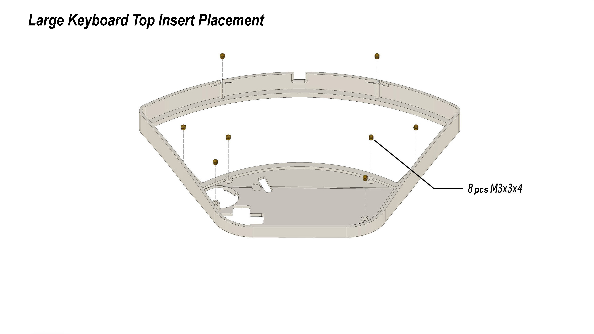

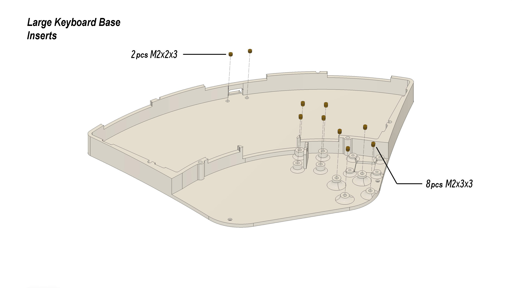

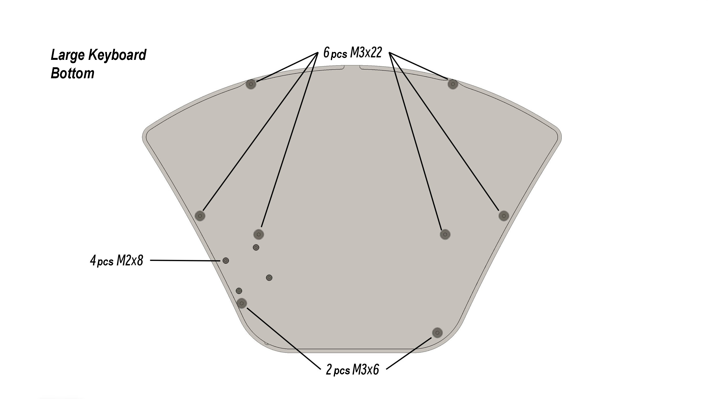

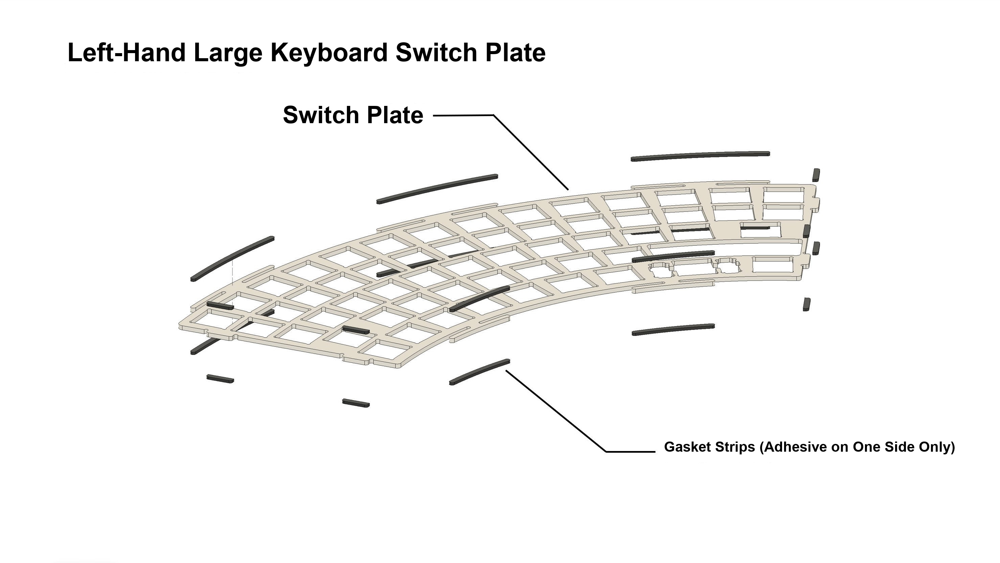

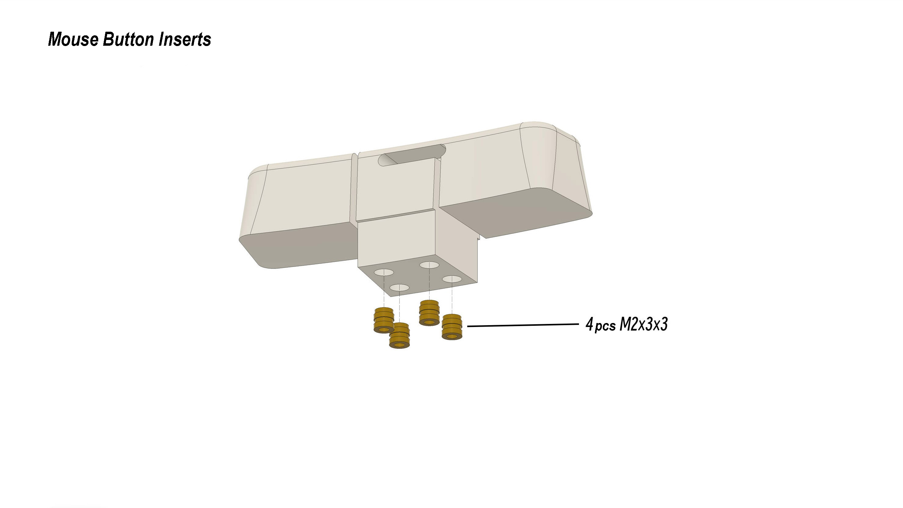

#### Small keyboard

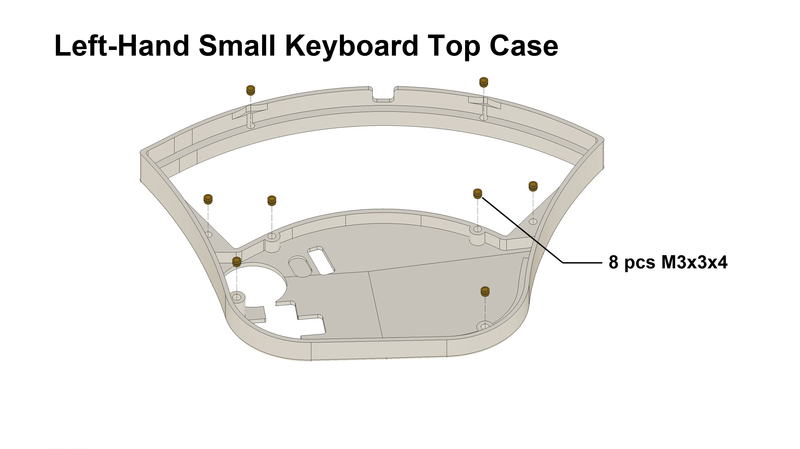

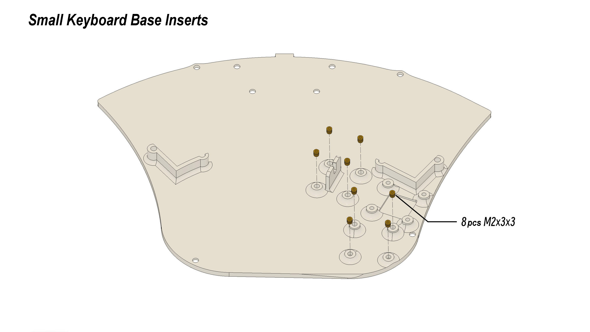

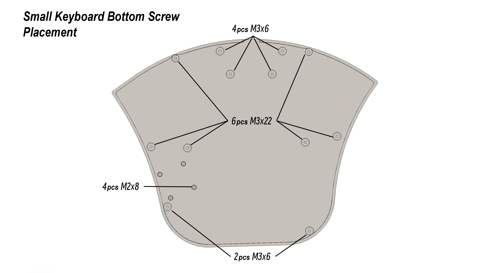

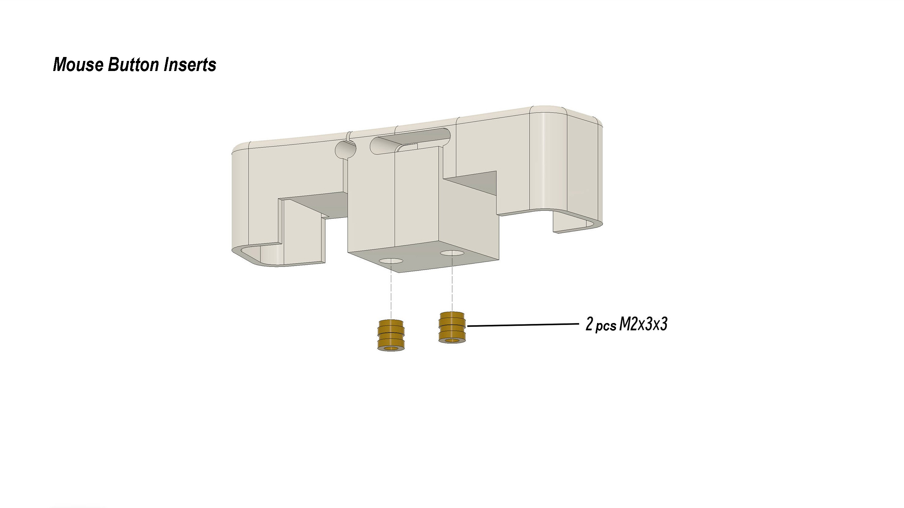

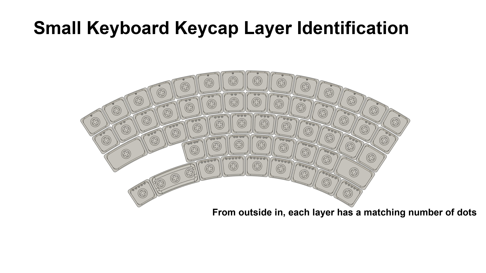

> The large keyboard's keycaps are identified the same way.

#### Other

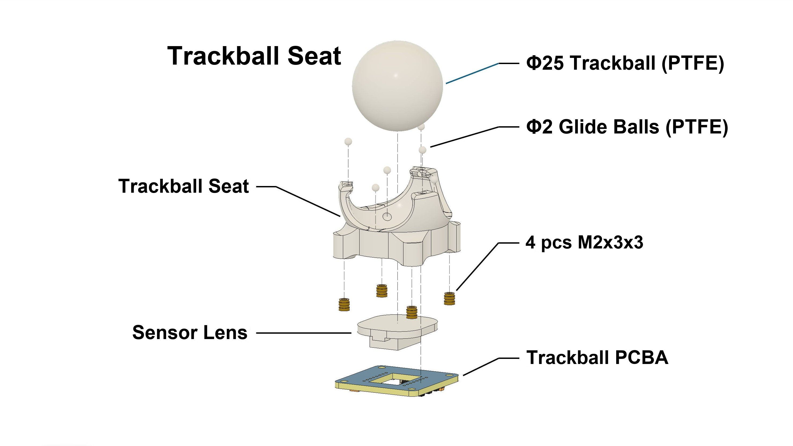
